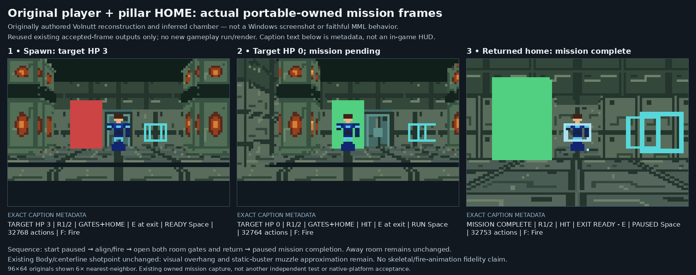
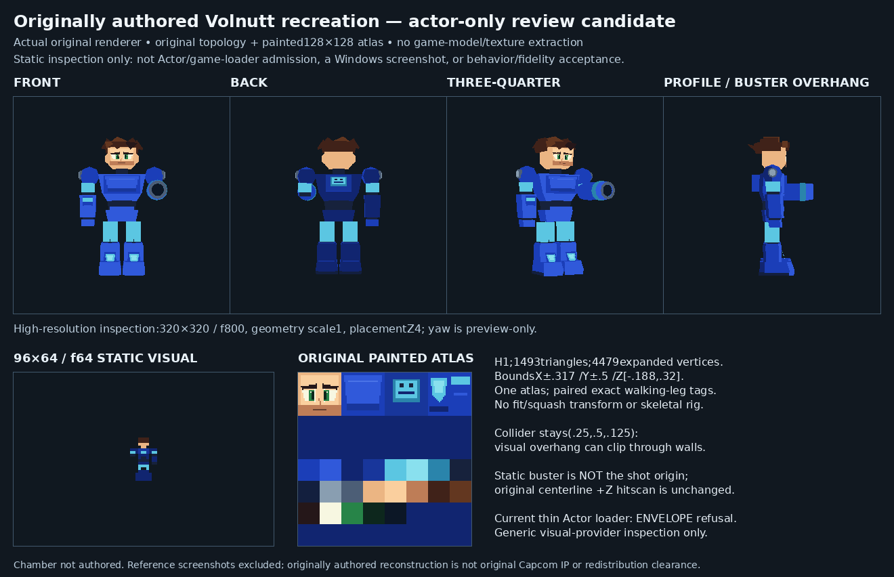
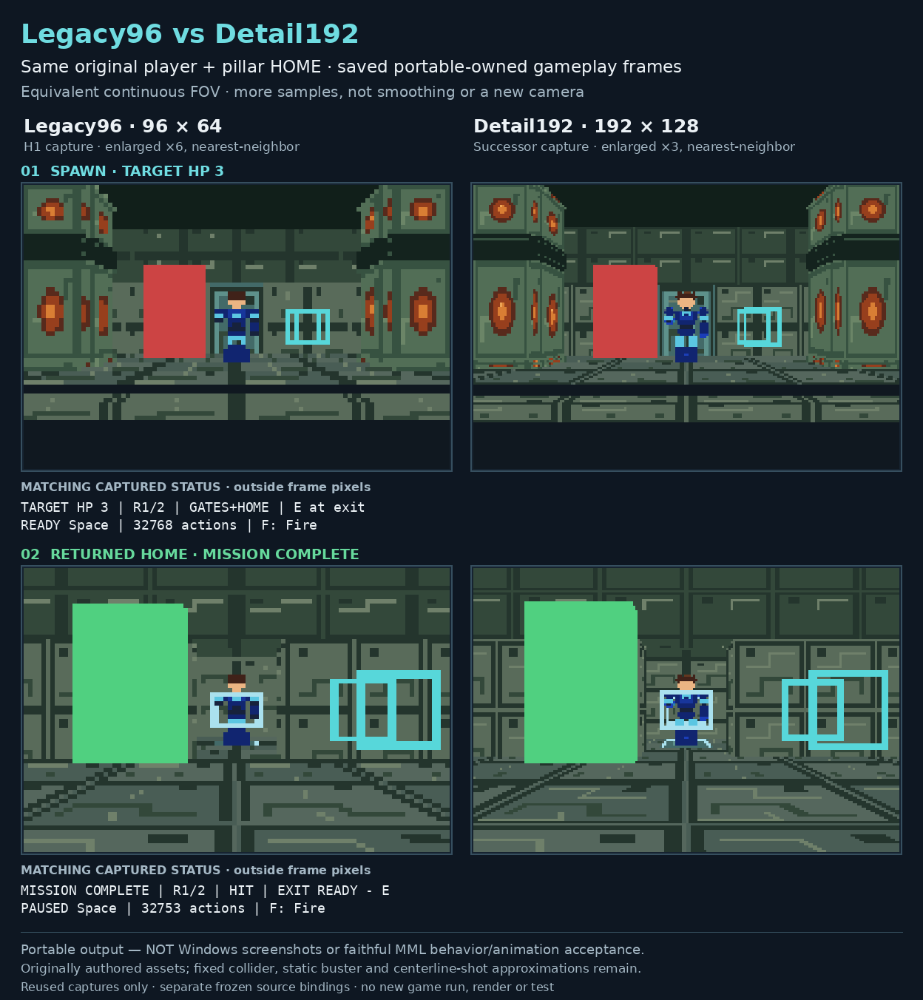

# Rock Man x64

A project working toward an independent **native Windows x64 Mega Man Legends 1 experience**, with an integrated editor for exploring and working with game data.

**Can I play it today?** There is no public playable build or game download here. Native game boot has not been established. A private prototype exists; this repository shares the documentation and research behind the work.

[**Explore the project and progress →**](https://raiinman.github.io/Rock-Man-x64/) · [**Build & spec plan**](https://raiinman.github.io/Rock-Man-x64/#build-plan) · [Read the project story](docs/history/README.md) · [Browse the research](research/README.md)

## Prototype gallery

Three owner-approved images from original prototype work. These images do not establish native Mega Man Legends boot, a playable release or faithful game behavior.

### H1 progression

Original fan-recreation player and pillar-room mission: spawn, practice target cleared, returned-home complete. Actual portable rendered frames; Windows presentation and faithful MML behavior remain unverified.

### Original actor inspection

Originally authored Volnutt-inspired actor, earlier actor-only static offscreen inspection. The embedded loader refusal and chamber-not-authored notes describe that earlier inspection, not current integrated mission status. Original mesh and painted atlas; skeletal/fire animation and Windows gameplay are not demonstrated by this sheet.

### Legacy96 and Detail192 comparison

Legacy96 (96×64) versus Detail192 (192×128), the same original player/room and saved mission stages at equivalent continuous FOV. Actual portable frames displayed with nearest-neighbor scaling. Windows presentation remains unverified.

[Open the gallery and scope notes](docs/gallery/README.md)

Original concept illustration

*Original AI-generated concept illustration for this documentation. Not a screenshot or game output.*

## What you can explore today

- **Progress:** a readable roadmap with accepted, pending and blocked milestones. Open any tile for the exact evidence.
- **The story so far:** decisions, experiments, corrections and the work still ahead.
- **Under the hood:** technical explanations and a sourced PS1 research library.

The goal includes a native game and editor. Documentation, research results and component tests are useful steps toward it; they do not establish playable gameplay, native boot or a release date.

<!-- ROCK-MAN-TRACKER:START -->

## Progress, in numbers

**This chart updates from reviewed data after eligible GitHub pushes.** The top bar counts accepted milestones in the named overall roadmap—not code, effort or how much of the game is finished. Local checklists and test pass rates remain separate.

**Where we are:** An original three-health retaliation encounter passed bounded Linux actual-consumer and independent checks plus a strict Windows cross-build. Its target responds every 64 accepted HOME steps; it has not run on Windows. Earlier H1, Detail192, HUD, bounded IDE and Windows shooting records keep their separate scopes.

**Next useful step:** As of this review, a separate original combat-cues successor is mutable and under testing. Await its terminal verification and independent review; no completion or Windows execution is claimed. Broader IDE work and provenance, initializer, S2 and native-game acceptance remain separate.

**Change since previous numeric review:** Frozen inspection delivery: Δ \+0 goals; Data-only observation path: Δ \+0 goals; Selected loader checkpoints: Δ \+0 goals; Live controller safety gates: Δ \+0 goals; Native game boot acceptance: Δ \+0 goals; Accepted roadmap milestones: Δ \+0 goals.

[Exact done criteria and evidence](docs/status/dashboard.md#named-checklists) · [Recorded changes](docs/status/changes.md#numeric-review-history) · [12 important discoveries](docs/status/dashboard.md#reconstruction-findings) · [How this stays current](docs/status/TRACKER.md)

**Last evidence review:** 2026-10-28 · `2026-10-28-retaliation-review-01` · [reviewed basis e7fd63f](https://github.com/raiinman/Rock-Man-x64/commit/e7fd63f20ff743a88aafdc268812ccc6100f6c5c).
**Latest repository change observed:** [200b149](https://github.com/raiinman/Rock-Man-x64/commit/200b14916d713cc67e83b262436d52cb6f1318b9) · 2026-10-28T09:47:09-07:00 — docs: record bounded original retaliation evidence.
**Authored evidence update supplied:** the evidence file and its review identifier changed in the observed commit. Stages still mean only what the cited reviewed record establishes.

<!-- ROCK-MAN-TRACKER:END -->

## Follow the evidence

| I want… | Go here |
|---|---|
| Reading paths and documentation ownership | [Documentation guide](docs/README.md) |
| Public work requests and coordination | [Coordination entry point](DOT.md) · [Dated handoff](docs/status/decisions-and-handoff.md) |
| Every visual claim, its source and its limit | [Dashboard evidence ledger](docs/status/dashboard.md) |
| Exact current blockers and test scopes | [Current status](docs/status/current-status.md) · [Validation](docs/status/validation.md) |
| The full story, including failures and corrections | [Project history](docs/history/README.md) |
| Architecture and investigated capabilities | [Technical guide](docs/technical/architecture.md) · [Capability matrix](docs/technical/capability-matrix.md) |
| Capability boundaries and spec-driven workflow | [Capability map](CAPABILITIES.md) · [Shared specification](SPEC.md) |
| PS1 research and its implementation restrictions | [Research library](research/README.md) · [Provenance review](research/bios/PROVENANCE-REVIEW.md) |

Private results are summarized in sanitized prose and are **not independently reproducible from this repository**. Executed emulator research is not native-game boot. Source references, test oracles and implementation lineage remain separate; PSX-SPX is a restricted-provenance research reference, not cleared implementation authority. Independent implementation is the project constraint, not a legally certified clean-room claim.

Documentation maintenance and DOX licensing

Read [AGENTS.md](AGENTS.md) and the relevant child contract before editing. Preserve history and evidence limits when updating the current status; do not turn a component success into a completion claim.

The documentation hierarchy is adapted from [raiinman/dox](https://github.com/raiinman/dox) at commit [b88194c34ace1a2a3dc01831d36b8a65986a41f5](https://github.com/raiinman/dox/commit/b88194c34ace1a2a3dc01831d36b8a65986a41f5). Its project-specific indexes replace the source repository's indexes and artwork rules.

DOX copyright (c) 2026 Agent Zero; its MIT license is preserved verbatim in [DOX-LICENSE](DOX-LICENSE). That notice is for the imported DOX framework, not a newly granted license for the whole project or third-party game content.

