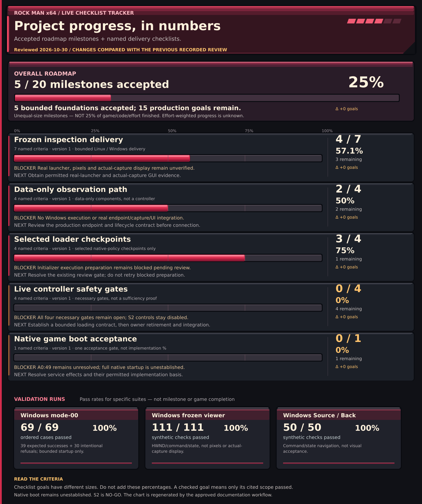
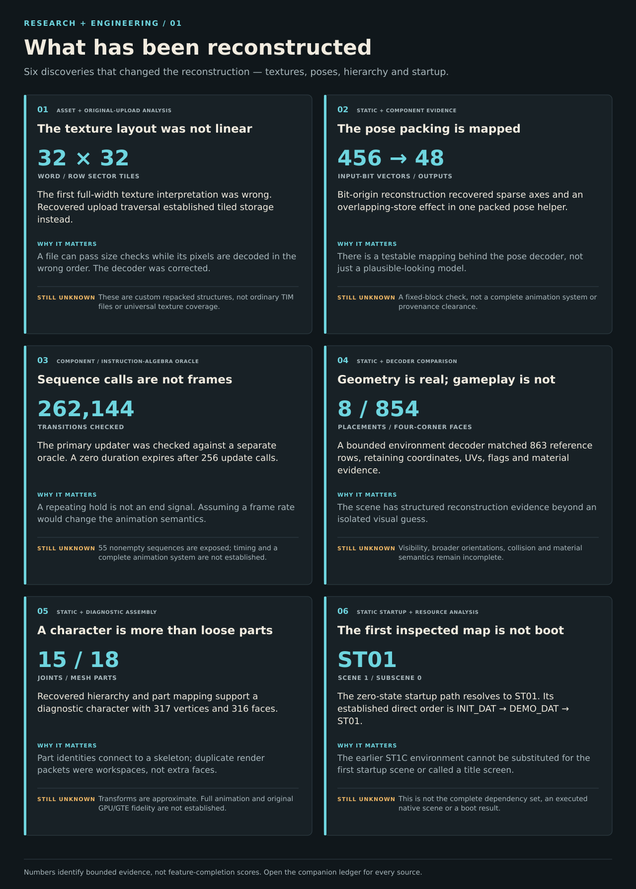
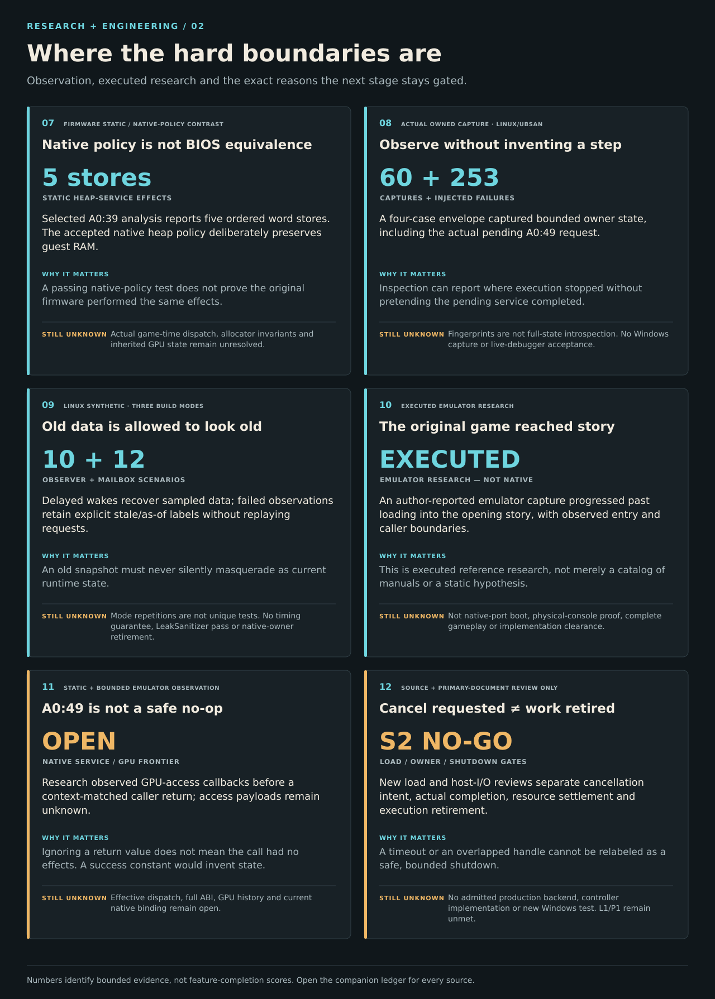

# Living evidence tracker and findings

Generated from reviewed evidence data. This is documentation, not a playable game or a public test package.

**Last evidence review:** 2026-10-24 · `2026-10-24-apex-a049-contract-deferred-01` · [reviewed basis b1afbcb](https://github.com/raiinman/Rock-Man-x64/commit/b1afbcb7a113c4b25b8c899ab5325b74eaf36961).
**Latest repository change observed:** [6ea5381](https://github.com/raiinman/Rock-Man-x64/commit/6ea5381e26f478fd421e3811405f1986ccc0fbf1) · 2026-10-23T17:04:20-07:00 — docs: add full-page red milestone heatmap and verified delivery review.
**Authored evidence update supplied:** the evidence file and its review identifier changed in the observed commit. Stages still mean only what the cited reviewed record establishes.

## Named checklists

The overall roadmap is a separately defined whole-project milestone plan. Its percentage counts unequal-sized accepted milestones, not game/code/effort completion; effort-weighted completion is unknown. The five local checklists overlap it and are never added or averaged into the overall score. Test pass rates are separate.

**Latest numeric change:** Frozen inspection delivery: Δ \+0 goals; Data-only observation path: Δ \+0 goals; Selected loader checkpoints: Δ \+0 goals; Live controller safety gates: Δ \+0 goals; Native game boot acceptance: Δ \+0 goals; Accepted roadmap milestones: Δ \+0 goals.

### roadmap — Accepted roadmap milestones

**5 / 20 accepted · 25.0% · 15 remaining · Δ +0 goals.** Definition v1, frozen 2026-10-23.

A named whole-project delivery roadmap for the native game and integrated IDE, including bounded foundations and unaccepted product domains. This is an unweighted count of milestones, not effort/code completeness, an ETA or an average of local checklists. Weighted-effort completion is unknown.

**Blocker:** Native boot, complete gameplay and the integrated live IDE are not accepted.

**Next:** Resolve the current native service and lifecycle gates; follow the remaining roadmap criteria.

| Accepted? | Named criterion and exact done condition | Evidence class / source |
|---|---|---|
| YES | **Read-only source inventory** — Establish source identity, ISO inventory and bounded logical Form1 export without changing original media; authenticity and unsupported media stay qualified. | Reported source inventory and bounded export · [evidence](../../docs/history/milestones.md#2-disc-integrity-and-bounded-export) |
| YES | **Diagnostic asset reconstruction** — Establish bounded tiled texture, mesh, assembled-character and static-environment inspection; this milestone excludes full coverage, production rendering and scene execution. | Reported static/component diagnostic reconstruction · [evidence](../../docs/technical/capability-matrix.md) |
| YES | **Source-bound offline editor foundation** — Establish the bounded offline transform-edit/history/sidecar foundation, with portable and frozen synthetic Windows evidence; not a complete current IDE, live apply workflow or pixel acceptance. | Reported portable and frozen Windows synthetic evidence · [evidence](../../docs/history/validation-history.md#delegated-authorized-windows-test-machine-results) · [evidence](../../docs/technical/architecture.md#editor-boundary) |
| YES | **Native Windows CD startup slice** — Accept the bounded mode-00 path using a real same-image reader, FIFO/response/IRQ/callback ownership and reviewed Windows execution, stopping honestly at the unsupported continuation. | Reported authorized Windows execution · [evidence](../../docs/status/current-status.md#accepted-native-windows-mode-00-stage) |
| YES | **Owned snapshot and portable inspection** — Accept bounded actual owner capture and an actual producer-artifact-portable-model round trip; no live controller or Windows GUI display is implied. | Actual Linux capture and portable export/import · [evidence](../../docs/status/current-status.md#actual-portable-exportimport-and-bounded-windows-viewer-acceptance) · [evidence](../../docs/status/current-status.md#bounded-actual-owned-capture) |
| NO — pending | **Native original-game boot** — Accept native Windows startup reaching the required initial game state under an identified authorized run, without a BIOS/emulator runtime dependency. | Native boot unestablished · [evidence](../../docs/status/current-status.md#evidence-limits-and-next-steps) |
| NO — pending | **Production scene and resource lifecycle** — Accept real production scene entry, resource dependencies, visibility/lifetime transitions and teardown, not a static union-geometry view or synthetic first-scene fixture. | Production scene lifecycle unestablished · [evidence](../../docs/technical/capability-matrix.md) |
| NO — pending | **Production renderer fidelity** — Accept the required production GPU/GTE, texture/material and rendering semantics against bounded stated references, beyond the approximate CPU diagnostic renderer. | Diagnostic subset only · [evidence](../../docs/technical/architecture.md#assets-and-rendering) |
| NO — pending | **Complete character animation** — Accept integrated pose, animation sequence, transform and timing behavior for the required game use cases; a fixed helper or update-call oracle alone is insufficient. | Bounded helpers only · [evidence](../../docs/history/milestones.md#6-reconstruct-diagnostic-character-poses-and-sequence-stepping) |
| NO — pending | **Player controls and camera** — Demonstrate integrated player input, motion and camera behavior in an accepted native gameplay session. | Gameplay target only · [evidence](../../docs/technical/capability-matrix.md) |
| NO — pending | **Collision and world interaction** — Accept required collision, triggers and world-interaction behavior in production scenes, not merely recovered coordinates. | Gameplay target only · [evidence](../../docs/technical/capability-matrix.md) |
| NO — pending | **AI, combat and progression** — Accept representative required AI, combat and game-progression behavior in native play, with explicit remaining-coverage limits. | Gameplay target only · [evidence](../../docs/technical/capability-matrix.md) |
| NO — pending | **Decoded audio, music and output** — Accept required decoding, music/stream handling and audible native output; nonexecuting sound plans and a CPU mixer checkpoint do not satisfy it. | No accepted decoding/output/playback · [evidence](../../docs/technical/capability-matrix.md) |
| NO — pending | **Game save/load compatibility** — Accept game-state persistence, load/restore and required compatibility; editor sidecars are a different feature. | Game save compatibility unestablished · [evidence](../../docs/technical/capability-matrix.md) |
| NO — pending | **Actual-capture Windows viewer** — Accept the real standalone launcher, pixel behavior and actual owned-capture GUI display, not synthetic HWND/host-function checks alone. | Visual/launcher/capture acceptance pending · [evidence](../../docs/status/current-status.md#standalone-viewer-lifecycle-and-remaining-access-gates) |
| NO — pending | **Safe live runtime controller** — Close necessary production loading, owner-retirement, stop/fault and endpoint lifecycle obligations and accept integrated runtime control; four source reviews alone are insufficient. | Source-only NO-GO · [evidence](../../docs/status/current-status.md#ide-runtime-controller-source-only-feasibility-no-go) |
| NO — pending | **Complete integrated IDE workflow** — Accept the intended complete integrated inspection/edit/debug workflow with real runtime interaction, persistence, failures and safe shutdown, not isolated inspection foundations. | Complete IDE unestablished · [evidence](../../docs/technical/architecture.md#editor-boundary) |
| NO — pending | **Implementation provenance review** — Complete the project-specific independent-implementation provenance review for adopted runtime behavior and references; restricted research remains separate and no legal clean-room certification is implied. | Implementation clearance unresolved · [evidence](../../research/bios/PROVENANCE-REVIEW.md) |
| NO — pending | **Native Windows package acceptance** — Accept the authorized native Windows package/install/run workflow with its required original inputs kept separate; frozen component kits or cross-builds do not establish product packaging. | No game release acceptance · [evidence](../../docs/technical/capability-matrix.md) |
| NO — pending | **End-to-end native game acceptance** — Accept a defined representative native game journey with the integrated IDE and required product behavior; component tests, emulator research and boot alone are insufficient. | No playable game or full-application acceptance · [evidence](../../docs/status/current-status.md#data-only-observer-linux-synthetic-acceptance) |

### inspection — Frozen inspection delivery

**4 / 7 accepted · 57.1% · 3 remaining · Δ +0 goals.** Definition v1, frozen 2026-10-23.

Seven named delivery checkpoints, mixing separately labeled Linux and Windows scopes. A local checklist, not full IDE completion.

**Blocker:** Real launcher, pixels and actual-capture display remain unverified.

**Next:** Obtain permitted real-launcher and actual-capture GUI evidence.

| Accepted? | Named criterion and exact done condition | Evidence class / source |
|---|---|---|
| YES | **Owned startup capture** — Accept an actual bounded same-owner capture run with non-mutation and cleanup review. | Actual Linux/UBSan · [evidence](../../docs/status/current-status.md#bounded-actual-owned-capture) |
| YES | **Portable export/import** — Accept an actual producer-to-artifact-to-portable-model round trip. | Actual Linux export/import · [evidence](../../docs/status/current-status.md#actual-portable-exportimport-and-bounded-windows-viewer-acceptance) |
| YES | **Frozen viewer commands** — Accept the frozen Windows viewer synthetic HWND/command/state suite. | Reported Windows synthetic execution · [evidence](../../docs/status/current-status.md#separately-approved-windows-viewer-result) |
| YES | **Standalone host lifecycle** — Accept the standalone viewer synthetic host-function lifecycle checks. | Reported Windows synthetic execution · [evidence](../../docs/status/current-status.md#standalone-viewer-lifecycle-and-remaining-access-gates) |
| NO — pending | **Real standalone launcher** — Verify the real standalone launcher, separately from host-function tests. | Pending real-launcher acceptance · [evidence](../../docs/status/current-status.md#standalone-viewer-lifecycle-and-remaining-access-gates) |
| NO — pending | **Visual correctness** — Accept a permitted pixel/visual inspection of the standalone viewer. | Blocked visual acceptance · [evidence](../../docs/status/current-status.md#standalone-viewer-lifecycle-and-remaining-access-gates) |
| NO — pending | **Actual-capture GUI display** — Verify actual owned capture display in the Windows GUI, not synthetic fixtures. | Pending actual-capture GUI acceptance · [evidence](../../docs/status/current-status.md#separately-approved-windows-viewer-result) |

### observation — Data-only observation path

**2 / 4 accepted · 50.0% · 2 remaining · Δ +0 goals.** Definition v1, frozen 2026-10-23.

Four named delivery checkpoints. Linux synthetic components are not native controller or GUI integration.

**Blocker:** No Windows execution or real endpoint/capture/UI integration.

**Next:** Review the production endpoint and lifecycle contract before connection.

| Accepted? | Named criterion and exact done condition | Evidence class / source |
|---|---|---|
| YES | **Observation mailbox** — Accept the twelve distinct synthetic mailbox scenarios within the recorded Linux envelope. | Linux synthetic component · [evidence](../../docs/status/current-status.md#isolated-observation-mailbox-synthetic-acceptance-only) |
| YES | **Data-only observer** — Accept the ten observer scenarios, including delayed notices and honest stale/as-of data. | Linux synthetic component · [evidence](../../docs/status/current-status.md#data-only-observer-linux-synthetic-acceptance) |
| NO — pending | **Windows qualification** — Accept Windows execution of the data-only mailbox/observer path. | Pending Windows acceptance · [evidence](../../docs/status/current-status.md#data-only-observer-linux-synthetic-acceptance) |
| NO — pending | **Real endpoint integration** — Accept actual endpoint/capture/UI integration without implying native-owner retirement. | Pending integration acceptance · [evidence](../../docs/status/current-status.md#data-only-observer-linux-synthetic-acceptance) |

### loader — Selected loader checkpoints

**3 / 4 accepted · 75.0% · 1 remaining · Δ +0 goals.** Definition v1, frozen 2026-10-23.

Four bounded native-policy compatibility checkpoints. Not BIOS equivalence, a complete loader or game boot.

**Blocker:** Initializer execution preparation remains blocked pending review.

**Next:** Resolve the existing review gate; do not retry blocked preparation.

| Accepted? | Named criterion and exact done condition | Evidence class / source |
|---|---|---|
| YES | **Loader prefix** — Accept an authorized original-input Linux compatibility run stopping at pending A0:39. | Actual Linux native-policy compatibility · [evidence](../../docs/status/current-status.md#native-loader-prefix-compatibility-not-firmware-execution) |
| YES | **Native heap policy** — Accept the authorized Linux compatibility run to the native heap-policy return boundary. | Actual Linux native policy, not BIOS · [evidence](../../docs/status/current-status.md#later-native-policy-heap-and-continuation-acceptance) |
| YES | **Fixed continuation** — Accept the authorized Linux continuation stopping before the initializer. | Actual Linux native-policy compatibility · [evidence](../../docs/status/current-status.md#later-native-policy-heap-and-continuation-acceptance) |
| NO — pending | **Actual-input initializer** — Obtain authorized actual-input initializer acceptance; source/synthetic checks alone do not satisfy this goal. | Execution blocked; synthetic-only evidence · [evidence](../../docs/status/current-status.md#initializer-candidate-synthetic-only-execution-blocked) |

### s2 — Live controller safety gates

**0 / 4 accepted · 0.0% · 4 remaining · Δ +0 goals.** Definition v1, frozen 2026-10-23.

Four named necessary lifecycle gates from the current NO-GO. They are not an exhaustive sufficiency proof or full controller completion.

**Blocker:** All four necessary gates remain open; S2 controls stay disabled.

**Next:** Establish a bounded loading contract, then owner retirement and integration.

| Accepted? | Named criterion and exact done condition | Evidence class / source |
|---|---|---|
| NO — pending | **Bounded load termination** — Establish an accepted production loading cancellation/termination and wall-time contract. | Source review NO-GO · [evidence](../../docs/status/current-status.md#ide-runtime-controller-source-only-feasibility-no-go) |
| NO — pending | **Whole-owner retirement** — Establish an accepted whole-owner retirement transition, not merely completed mailbox records. | Source review NO-GO · [evidence](../../docs/status/current-status.md#ide-runtime-controller-source-only-feasibility-no-go) |
| NO — pending | **Single-call stop/fault** — Establish accepted single-call stop/fault semantics without inventing rollback or deadlines. | Source review NO-GO · [evidence](../../docs/status/current-status.md#ide-runtime-controller-source-only-feasibility-no-go) |
| NO — pending | **Real endpoint lifecycle** — Establish accepted endpoint/capture/UI ownership and worker/mailbox finalization. | Source review NO-GO · [evidence](../../docs/status/current-status.md#data-only-observer-linux-synthetic-acceptance) |

### boot — Native game boot acceptance

**0 / 1 accepted · 0.0% · 1 remaining · Δ +0 goals.** Definition v1, frozen 2026-10-23.

One binary acceptance goal. Zero accepted boot goals does not mean zero development; this is not a percent of the game.

**Blocker:** A0:49 remains unresolved; full native startup is unestablished.

**Next:** Resolve service effects and their permitted implementation basis.

| Accepted? | Named criterion and exact done condition | Evidence class / source |
|---|---|---|
| NO — pending | **Native original-game boot** — Establish an authorized native Windows original-game boot result without a BIOS/emulator runtime dependency, with exact scope reviewed. | Native boot not established · [evidence](../../docs/status/current-status.md#evidence-limits-and-next-steps) |

### Validation pass rates — separate measurement

| Specific run | Passed / total | Pass rate | Scope |
|---|---|---|
| Windows mode-00 | 69 / 69 | 100.0% | 39 expected successes \+ 30 intentional refusals; bounded startup only. [evidence](../../docs/status/current-status.md#accepted-native-windows-mode-00-stage) |
| Windows frozen viewer | 111 / 111 | 100.0% | HWND/command/state, not pixels or actual-capture display. [evidence](../../docs/status/current-status.md#separately-approved-windows-viewer-result) |
| Windows Source / Back | 50 / 50 | 100.0% | Command/state navigation, not visual acceptance. [evidence](../../docs/status/current-status.md#combined-candidate-and-ide-update) |

## Numeric review history

Only recorded observations appear here. The first entry is a baseline, not a newly completed runtime milestone. A new checklist version starts a new comparison basis.

| Recorded review | Checklist version | Completed / total | Change note |
|---|---|---|---|
| 2026-10-23 · `2026-10-23-numeric-baseline-01` | inspection v1 | 4 / 7 | First numeric baseline from existing accepted records: five bounded roadmap foundations plus fifteen pending product goals, and five separate local checklists. No new runtime milestone or historical delta is invented. |
| 2026-10-23 · `2026-10-23-numeric-baseline-01` | observation v1 | 2 / 4 | First numeric baseline from existing accepted records: five bounded roadmap foundations plus fifteen pending product goals, and five separate local checklists. No new runtime milestone or historical delta is invented. |
| 2026-10-23 · `2026-10-23-numeric-baseline-01` | loader v1 | 3 / 4 | First numeric baseline from existing accepted records: five bounded roadmap foundations plus fifteen pending product goals, and five separate local checklists. No new runtime milestone or historical delta is invented. |
| 2026-10-23 · `2026-10-23-numeric-baseline-01` | s2 v1 | 0 / 4 | First numeric baseline from existing accepted records: five bounded roadmap foundations plus fifteen pending product goals, and five separate local checklists. No new runtime milestone or historical delta is invented. |
| 2026-10-23 · `2026-10-23-numeric-baseline-01` | boot v1 | 0 / 1 | First numeric baseline from existing accepted records: five bounded roadmap foundations plus fifteen pending product goals, and five separate local checklists. No new runtime milestone or historical delta is invented. |
| 2026-10-23 · `2026-10-23-numeric-baseline-01` | roadmap v1 | 5 / 20 | First numeric baseline from existing accepted records: five bounded roadmap foundations plus fifteen pending product goals, and five separate local checklists. No new runtime milestone or historical delta is invented. |
| 2026-10-23 · `2026-10-23-importer-boundary-02` | inspection v1 | 4 / 7 | Accepted isolated importer correction, not production integration. All accepted criterion IDs and versions remain unchanged; this records zero milestone delta. |
| 2026-10-23 · `2026-10-23-importer-boundary-02` | observation v1 | 2 / 4 | Accepted isolated importer correction, not production integration. All accepted criterion IDs and versions remain unchanged; this records zero milestone delta. |
| 2026-10-23 · `2026-10-23-importer-boundary-02` | loader v1 | 3 / 4 | Accepted isolated importer correction, not production integration. All accepted criterion IDs and versions remain unchanged; this records zero milestone delta. |
| 2026-10-23 · `2026-10-23-importer-boundary-02` | s2 v1 | 0 / 4 | Accepted isolated importer correction, not production integration. All accepted criterion IDs and versions remain unchanged; this records zero milestone delta. |
| 2026-10-23 · `2026-10-23-importer-boundary-02` | boot v1 | 0 / 1 | Accepted isolated importer correction, not production integration. All accepted criterion IDs and versions remain unchanged; this records zero milestone delta. |
| 2026-10-23 · `2026-10-23-importer-boundary-02` | roadmap v1 | 5 / 20 | Accepted isolated importer correction, not production integration. All accepted criterion IDs and versions remain unchanged; this records zero milestone delta. |
| 2026-10-23 · `2026-10-23-viewer-reliability-01` | inspection v1 | 4 / 7 | Isolated viewer reliability and Windows-target link evidence only. No Windows execution or production acceptance; all criterion IDs/versions are preserved with zero milestone delta. |
| 2026-10-23 · `2026-10-23-viewer-reliability-01` | observation v1 | 2 / 4 | Isolated viewer reliability and Windows-target link evidence only. No Windows execution or production acceptance; all criterion IDs/versions are preserved with zero milestone delta. |
| 2026-10-23 · `2026-10-23-viewer-reliability-01` | loader v1 | 3 / 4 | Isolated viewer reliability and Windows-target link evidence only. No Windows execution or production acceptance; all criterion IDs/versions are preserved with zero milestone delta. |
| 2026-10-23 · `2026-10-23-viewer-reliability-01` | s2 v1 | 0 / 4 | Isolated viewer reliability and Windows-target link evidence only. No Windows execution or production acceptance; all criterion IDs/versions are preserved with zero milestone delta. |
| 2026-10-23 · `2026-10-23-viewer-reliability-01` | boot v1 | 0 / 1 | Isolated viewer reliability and Windows-target link evidence only. No Windows execution or production acceptance; all criterion IDs/versions are preserved with zero milestone delta. |
| 2026-10-23 · `2026-10-23-viewer-reliability-01` | roadmap v1 | 5 / 20 | Isolated viewer reliability and Windows-target link evidence only. No Windows execution or production acceptance; all criterion IDs/versions are preserved with zero milestone delta. |
| 2026-10-23 · `2026-10-23-pages-tracker-01` | inspection v1 | 4 / 7 | Documentation UI and Pages pipeline source review only. Offline checks do not establish a live site or browser acceptance. All criterion definitions, accepted flags and milestone counts are unchanged; zero delta. |
| 2026-10-23 · `2026-10-23-pages-tracker-01` | observation v1 | 2 / 4 | Documentation UI and Pages pipeline source review only. Offline checks do not establish a live site or browser acceptance. All criterion definitions, accepted flags and milestone counts are unchanged; zero delta. |
| 2026-10-23 · `2026-10-23-pages-tracker-01` | loader v1 | 3 / 4 | Documentation UI and Pages pipeline source review only. Offline checks do not establish a live site or browser acceptance. All criterion definitions, accepted flags and milestone counts are unchanged; zero delta. |
| 2026-10-23 · `2026-10-23-pages-tracker-01` | s2 v1 | 0 / 4 | Documentation UI and Pages pipeline source review only. Offline checks do not establish a live site or browser acceptance. All criterion definitions, accepted flags and milestone counts are unchanged; zero delta. |
| 2026-10-23 · `2026-10-23-pages-tracker-01` | boot v1 | 0 / 1 | Documentation UI and Pages pipeline source review only. Offline checks do not establish a live site or browser acceptance. All criterion definitions, accepted flags and milestone counts are unchanged; zero delta. |
| 2026-10-23 · `2026-10-23-pages-tracker-01` | roadmap v1 | 5 / 20 | Documentation UI and Pages pipeline source review only. Offline checks do not establish a live site or browser acceptance. All criterion definitions, accepted flags and milestone counts are unchanged; zero delta. |
| 2026-10-23 · `2026-10-23-execution-hosting-limits-01` | inspection v1 | 4 / 7 | Verified transfer, inconclusive Windows launch attempt and failed Pages deployment; no runtime or hosting acceptance and zero milestone delta. Prior criteria, counts and observations are preserved. |
| 2026-10-23 · `2026-10-23-execution-hosting-limits-01` | observation v1 | 2 / 4 | Verified transfer, inconclusive Windows launch attempt and failed Pages deployment; no runtime or hosting acceptance and zero milestone delta. Prior criteria, counts and observations are preserved. |
| 2026-10-23 · `2026-10-23-execution-hosting-limits-01` | loader v1 | 3 / 4 | Verified transfer, inconclusive Windows launch attempt and failed Pages deployment; no runtime or hosting acceptance and zero milestone delta. Prior criteria, counts and observations are preserved. |
| 2026-10-23 · `2026-10-23-execution-hosting-limits-01` | s2 v1 | 0 / 4 | Verified transfer, inconclusive Windows launch attempt and failed Pages deployment; no runtime or hosting acceptance and zero milestone delta. Prior criteria, counts and observations are preserved. |
| 2026-10-23 · `2026-10-23-execution-hosting-limits-01` | boot v1 | 0 / 1 | Verified transfer, inconclusive Windows launch attempt and failed Pages deployment; no runtime or hosting acceptance and zero milestone delta. Prior criteria, counts and observations are preserved. |
| 2026-10-23 · `2026-10-23-execution-hosting-limits-01` | roadmap v1 | 5 / 20 | Verified transfer, inconclusive Windows launch attempt and failed Pages deployment; no runtime or hosting acceptance and zero milestone delta. Prior criteria, counts and observations are preserved. |
| 2026-10-23 · `2026-10-23-apex-public-handoff-01` | inspection v1 | 4 / 7 | Public-source-only temporary coordination handoff; no new runtime evidence or acceptance. All checklist definitions, accepted criterion IDs and versions are unchanged; zero milestone delta. |
| 2026-10-23 · `2026-10-23-apex-public-handoff-01` | observation v1 | 2 / 4 | Public-source-only temporary coordination handoff; no new runtime evidence or acceptance. All checklist definitions, accepted criterion IDs and versions are unchanged; zero milestone delta. |
| 2026-10-23 · `2026-10-23-apex-public-handoff-01` | loader v1 | 3 / 4 | Public-source-only temporary coordination handoff; no new runtime evidence or acceptance. All checklist definitions, accepted criterion IDs and versions are unchanged; zero milestone delta. |
| 2026-10-23 · `2026-10-23-apex-public-handoff-01` | s2 v1 | 0 / 4 | Public-source-only temporary coordination handoff; no new runtime evidence or acceptance. All checklist definitions, accepted criterion IDs and versions are unchanged; zero milestone delta. |
| 2026-10-23 · `2026-10-23-apex-public-handoff-01` | boot v1 | 0 / 1 | Public-source-only temporary coordination handoff; no new runtime evidence or acceptance. All checklist definitions, accepted criterion IDs and versions are unchanged; zero milestone delta. |
| 2026-10-23 · `2026-10-23-apex-public-handoff-01` | roadmap v1 | 5 / 20 | Public-source-only temporary coordination handoff; no new runtime evidence or acceptance. All checklist definitions, accepted criterion IDs and versions are unchanged; zero milestone delta. |
| 2026-10-23 · `2026-10-23-research-handoff-received-01` | inspection v1 | 4 / 7 | Research acknowledgment and proposed source-only coordination question; zero milestone delta. Definitions, accepted IDs and versions unchanged. |
| 2026-10-23 · `2026-10-23-research-handoff-received-01` | observation v1 | 2 / 4 | Research acknowledgment and proposed source-only coordination question; zero milestone delta. Definitions, accepted IDs and versions unchanged. |
| 2026-10-23 · `2026-10-23-research-handoff-received-01` | loader v1 | 3 / 4 | Research acknowledgment and proposed source-only coordination question; zero milestone delta. Definitions, accepted IDs and versions unchanged. |
| 2026-10-23 · `2026-10-23-research-handoff-received-01` | s2 v1 | 0 / 4 | Research acknowledgment and proposed source-only coordination question; zero milestone delta. Definitions, accepted IDs and versions unchanged. |
| 2026-10-23 · `2026-10-23-research-handoff-received-01` | boot v1 | 0 / 1 | Research acknowledgment and proposed source-only coordination question; zero milestone delta. Definitions, accepted IDs and versions unchanged. |
| 2026-10-23 · `2026-10-23-research-handoff-received-01` | roadmap v1 | 5 / 20 | Research acknowledgment and proposed source-only coordination question; zero milestone delta. Definitions, accepted IDs and versions unchanged. |
| 2026-10-23 · `2026-10-23-live-heatmap-docs-01` | inspection v1 | 4 / 7 | Actual Pages success and bounded prior-site browser checks, heatmap documentation presentation, and separately scoped owner launch/render observation. Zero accepted-milestone delta; all prior definitions, counts, failures and observations remain unchanged. New heatmap browser acceptance is pending publication. |
| 2026-10-23 · `2026-10-23-live-heatmap-docs-01` | observation v1 | 2 / 4 | Actual Pages success and bounded prior-site browser checks, heatmap documentation presentation, and separately scoped owner launch/render observation. Zero accepted-milestone delta; all prior definitions, counts, failures and observations remain unchanged. New heatmap browser acceptance is pending publication. |
| 2026-10-23 · `2026-10-23-live-heatmap-docs-01` | loader v1 | 3 / 4 | Actual Pages success and bounded prior-site browser checks, heatmap documentation presentation, and separately scoped owner launch/render observation. Zero accepted-milestone delta; all prior definitions, counts, failures and observations remain unchanged. New heatmap browser acceptance is pending publication. |
| 2026-10-23 · `2026-10-23-live-heatmap-docs-01` | s2 v1 | 0 / 4 | Actual Pages success and bounded prior-site browser checks, heatmap documentation presentation, and separately scoped owner launch/render observation. Zero accepted-milestone delta; all prior definitions, counts, failures and observations remain unchanged. New heatmap browser acceptance is pending publication. |
| 2026-10-23 · `2026-10-23-live-heatmap-docs-01` | boot v1 | 0 / 1 | Actual Pages success and bounded prior-site browser checks, heatmap documentation presentation, and separately scoped owner launch/render observation. Zero accepted-milestone delta; all prior definitions, counts, failures and observations remain unchanged. New heatmap browser acceptance is pending publication. |
| 2026-10-23 · `2026-10-23-live-heatmap-docs-01` | roadmap v1 | 5 / 20 | Actual Pages success and bounded prior-site browser checks, heatmap documentation presentation, and separately scoped owner launch/render observation. Zero accepted-milestone delta; all prior definitions, counts, failures and observations remain unchanged. New heatmap browser acceptance is pending publication. |
| 2026-10-24 · `2026-10-24-apex-a049-contract-deferred-01` | inspection v1 | 4 / 7 | Public coordination review checked at 2026-10-24 00:06 UTC. Contract selection deferred; no new native evidence or acceptance. All eight prior observations, checklist definitions, versions and accepted IDs are preserved; zero milestone delta. |
| 2026-10-24 · `2026-10-24-apex-a049-contract-deferred-01` | observation v1 | 2 / 4 | Public coordination review checked at 2026-10-24 00:06 UTC. Contract selection deferred; no new native evidence or acceptance. All eight prior observations, checklist definitions, versions and accepted IDs are preserved; zero milestone delta. |
| 2026-10-24 · `2026-10-24-apex-a049-contract-deferred-01` | loader v1 | 3 / 4 | Public coordination review checked at 2026-10-24 00:06 UTC. Contract selection deferred; no new native evidence or acceptance. All eight prior observations, checklist definitions, versions and accepted IDs are preserved; zero milestone delta. |
| 2026-10-24 · `2026-10-24-apex-a049-contract-deferred-01` | s2 v1 | 0 / 4 | Public coordination review checked at 2026-10-24 00:06 UTC. Contract selection deferred; no new native evidence or acceptance. All eight prior observations, checklist definitions, versions and accepted IDs are preserved; zero milestone delta. |
| 2026-10-24 · `2026-10-24-apex-a049-contract-deferred-01` | boot v1 | 0 / 1 | Public coordination review checked at 2026-10-24 00:06 UTC. Contract selection deferred; no new native evidence or acceptance. All eight prior observations, checklist definitions, versions and accepted IDs are preserved; zero milestone delta. |
| 2026-10-24 · `2026-10-24-apex-a049-contract-deferred-01` | roadmap v1 | 5 / 20 | Public coordination review checked at 2026-10-24 00:06 UTC. Contract selection deferred; no new native evidence or acceptance. All eight prior observations, checklist definitions, versions and accepted IDs are preserved; zero milestone delta. |

## Current explanation

**Now:** The public interactive tracker is live. The roadmap has 5 of 20 milestones accepted; native game boot and the complete IDE remain unaccepted. An owner-observed Inspector window is limited launch/render evidence, not controlled runtime acceptance.

**Changed:** Pages deployment succeeded after its earlier failures, and the prior site passed bounded desktop navigation/filter/keyboard checks. The new default heatmap presents the same reviewed milestones in warm armor red without changing acceptance.

**Why:** A full-page status map makes accepted foundations and remaining product goals visible. Website delivery, owner screenshots and native test acceptance are separate kinds of evidence.

**Next:** Verify the published heatmap in the supported browser. Native development can select or defer the source-only completion-contract review, naming its revision, owner, consumer and permitted provenance basis. Keep controlled Windows import/cancel/cleanup, native retirement, blocked initializer and provenance gates separate.

[Plain-English change ledger](changes.md) · [Update contract](TRACKER.md) · [Reviewed source data](dashboard-data.json)

## Evidence tracks

| Workstream | Source | Synthetic | Linux | Windows | Full app | Scope / next |
|---|---|---|---|---|---|---|
| Native CD mode-00 | Reviewed | Bounded evidence | Bounded evidence | Bounded evidence | — | 69 Windows cases · 30 intentional refusals. Stops at the unsupported graphics-startup continuation. **Next:** Resolve the unsupported graphics continuation; do not invent a service result. [evidence](../../docs/status/current-status.md#accepted-native-windows-mode-00-stage) |
| Graphics diagnostic | Reviewed | Bounded evidence | Bounded evidence | — | — | 19 connected Linux cases · A0:49 pending. No Windows parity or GPU initialization established. **Next:** Establish the missing A0:49 effects and permitted implementation basis. [evidence](../../docs/status/current-status.md#diagnostic-continuation-bounded-linux-acceptance) |
| Owned startup capture | Reviewed | Bounded evidence | Bounded evidence | — | — | 60 captures · 253 allocation-failure injections. Bounded Linux/UBSan owner observations, not a live debugger. **Next:** Keep capture observation separate from native stepping and UI acceptance. [evidence](../../docs/status/current-status.md#bounded-actual-owned-capture) |
| Export \+ frozen viewer | Reviewed | Bounded evidence | Bounded evidence | Bounded evidence | — | Linux model import / 111 Windows synthetic checks. Different bounded Linux/Windows scopes; no actual-capture GUI display or pixel acceptance. **Next:** Verify real-launcher, pixels and actual-capture display separately. [evidence](../../docs/status/current-status.md#separately-approved-windows-viewer-result) |
| Source bytes / Back | Reviewed | Bounded evidence | — | Bounded evidence | — | 50 Windows synthetic command/state checks. No Linux execution claim in this row; visual preflight blocked before launch. **Next:** Obtain a permitted visual check; do not infer pixels from command tests. [evidence](../../docs/status/current-status.md#combined-candidate-and-ide-update) |
| Mailbox \+ observer | Reviewed | Bounded evidence | Bounded evidence | — | — | 12 mailbox \+ 10 observer scenarios · Linux only. Data-only channel; no Windows or native-controller integration. **Next:** Review production lifecycle contracts before any native controller connection. [evidence](../../docs/status/current-status.md#data-only-observer-linux-synthetic-acceptance) |
| Loader continuation | Reviewed | Bounded evidence | Bounded evidence | — | — | Native policy · stops before the initializer. No BIOS equivalence; later initializer remains synthetic-only and execution-blocked. **Next:** Preserve the initializer execution gate and unresolved firmware effects. [evidence](../../docs/status/current-status.md#later-native-policy-heap-and-continuation-acceptance) |
| S2 live IDE controller | NO-GO review | — | — | — | — | Source review complete · production admission NO-GO. Load termination, owner retirement, stop/fault and real UI/capture integration remain unresolved. **Next:** Establish loading, ownership, stop/fault and real UI/capture contracts. [evidence](../../docs/status/current-status.md#ide-runtime-controller-source-only-feasibility-no-go) |

Platform and synthetic cells can describe the same run. They are not additive, equally weighted units or a game-completion percentage. Full app means end-to-end game or complete IDE, not a component integration.

The exporter/frozen-viewer row combines **different scopes**: one actual Linux artifact-to-portable-model import and Windows synthetic HWND/command/state checks. It does not establish actual-capture GUI display on Windows. See [evidence](../../docs/status/current-status.md#actual-portable-exportimport-and-bounded-windows-viewer-acceptance) and [evidence](../../docs/status/current-status.md#separately-approved-windows-viewer-result).

## Reconstruction findings

## 01 The texture layout was not linear

**Found:** The first full-width texture interpretation was wrong. Recovered upload traversal established tiled storage instead.

**Why it matters:** A file can pass size checks while its pixels are decoded in the wrong order. The decoder was corrected.

**Evidence:** ASSET \+ ORIGINAL-UPLOAD ANALYSIS. 32 × 32 — word / row sector tiles.

**Still unknown:** These are custom repacked structures, not ordinary TIM files or universal texture coverage.

**Sources:** [source 1](../../docs/history/milestones.md#4-recover-textures-and-local-model-parts) · [source 2](../../docs/technical/architecture.md#assets-and-rendering).

## 02 The pose packing is mapped

**Found:** Bit-origin reconstruction recovered sparse axes and an overlapping-store effect in one packed pose helper.

**Why it matters:** There is a testable mapping behind the pose decoder, not just a plausible-looking model.

**Evidence:** STATIC \+ COMPONENT EVIDENCE. 456 → 48 — input-bit vectors / outputs.

**Still unknown:** A fixed-block check, not a complete animation system or provenance clearance.

**Sources:** [source 1](../../docs/history/milestones.md#6-reconstruct-diagnostic-character-poses-and-sequence-stepping) · [source 2](../../docs/technical/capability-matrix.md).

## 03 Sequence calls are not frames

**Found:** The primary updater was checked against a separate oracle. A zero duration expires after 256 update calls.

**Why it matters:** A repeating hold is not an end signal. Assuming a frame rate would change the animation semantics.

**Evidence:** COMPONENT / INSTRUCTION-ALGEBRA ORACLE. 262,144 — transitions checked.

**Still unknown:** 55 nonempty sequences are exposed; timing and a complete animation system are not established.

**Sources:** [source 1](../../docs/history/milestones.md#6-reconstruct-diagnostic-character-poses-and-sequence-stepping).

## 04 Geometry is real; gameplay is not

**Found:** A bounded environment decoder matched 863 reference rows, retaining coordinates, UVs, flags and material evidence.

**Why it matters:** The scene has structured reconstruction evidence beyond an isolated visual guess.

**Evidence:** STATIC \+ DECODER COMPARISON. 8 / 854 — placements / four-corner faces.

**Still unknown:** Visibility, broader orientations, collision and material semantics remain incomplete.

**Sources:** [source 1](../../docs/history/milestones.md#7-recover-a-static-environment-then-distinguish-it-from-startup) · [source 2](../../docs/technical/capability-matrix.md).

## 05 A character is more than loose parts

**Found:** Recovered hierarchy and part mapping support a diagnostic character with 317 vertices and 316 faces.

**Why it matters:** Part identities connect to a skeleton; duplicate render packets were workspaces, not extra faces.

**Evidence:** STATIC \+ DIAGNOSTIC ASSEMBLY. 15 / 18 — joints / mesh parts.

**Still unknown:** Transforms are approximate. Full animation and original GPU/GTE fidelity are not established.

**Sources:** [source 1](../../docs/history/milestones.md#6-reconstruct-diagnostic-character-poses-and-sequence-stepping) · [source 2](../../docs/history/milestones.md#4-recover-textures-and-local-model-parts).

## 06 The first inspected map is not boot

**Found:** The zero-state startup path resolves to ST01. Its established direct order is INIT\_DAT → DEMO\_DAT → ST01.

**Why it matters:** The earlier ST1C environment cannot be substituted for the first startup scene or called a title screen.

**Evidence:** STATIC STARTUP \+ RESOURCE ANALYSIS. ST01 — scene 1 / subscene 0.

**Still unknown:** This is not the complete dependency set, an executed native scene or a boot result.

**Sources:** [source 1](../../docs/history/milestones.md#7-recover-a-static-environment-then-distinguish-it-from-startup).

## Frontier findings

## 07 Native policy is not BIOS equivalence

**Found:** Selected A0:39 analysis reports five ordered word stores. The accepted native heap policy deliberately preserves guest RAM.

**Why it matters:** A passing native-policy test does not prove the original firmware performed the same effects.

**Evidence:** FIRMWARE STATIC / NATIVE-POLICY CONTRAST. 5 stores — static heap-service effects.

**Still unknown:** Actual game-time dispatch, allocator invariants and inherited GPU state remain unresolved.

**Sources:** [source 1](../../docs/status/current-status.md#new-static-heap-evidence-does-not-establish-equivalence) · [source 2](../../research/bios/HEAP-INITIALIZATION.md#arguments-and-ordered-memory-effects) · [source 3](../../research/bios/PROVENANCE-REVIEW.md).

## 08 Observe without inventing a step

**Found:** A four-case envelope captured bounded owner state, including the actual pending A0:49 request.

**Why it matters:** Inspection can report where execution stopped without pretending the pending service completed.

**Evidence:** ACTUAL OWNED CAPTURE · LINUX/UBSAN. 60 \+ 253 — captures \+ injected failures.

**Still unknown:** Fingerprints are not full-state introspection. No Windows capture or live-debugger acceptance.

**Sources:** [source 1](../../docs/status/current-status.md#bounded-actual-owned-capture).

## 09 Old data is allowed to look old

**Found:** Delayed wakes recover sampled data; failed observations retain explicit stale/as-of labels without replaying requests.

**Why it matters:** An old snapshot must never silently masquerade as current runtime state.

**Evidence:** LINUX SYNTHETIC · THREE BUILD MODES. 10 \+ 12 — observer \+ mailbox scenarios.

**Still unknown:** Mode repetitions are not unique tests. No timing guarantee, LeakSanitizer pass or native-owner retirement.

**Sources:** [source 1](../../docs/status/current-status.md#data-only-observer-linux-synthetic-acceptance) · [source 2](../../docs/status/validation.md#observer-candidate-validation--october-23).

## 10 The original game reached story

**Found:** An author-reported emulator capture progressed past loading into the opening story, with observed entry and caller boundaries.

**Why it matters:** This is executed reference research, not merely a catalog of manuals or a static hypothesis.

**Evidence:** EXECUTED EMULATOR RESEARCH. EXECUTED — emulator research — not native.

**Still unknown:** Not native-port boot, physical-console proof, complete gameplay or implementation clearance.

**Sources:** [source 1](../../research/bios/ORIGINAL-GAME-STARTUP.md#past-loading-capture-and-first-call-detail) · [source 2](../../research/bios/PROVENANCE-REVIEW.md).

## 11 A0:49 is not a safe no-op

**Found:** Research observed GPU-access callbacks before a context-matched caller return; access payloads remain unknown.

**Why it matters:** Ignoring a return value does not mean the call had no effects. A success constant would invent state.

**Evidence:** STATIC \+ BOUNDED EMULATOR OBSERVATION. OPEN — native service / gpu frontier.

**Still unknown:** Effective dispatch, full ABI, GPU history and current native binding remain open.

**Sources:** [source 1](../../research/bios/ORIGINAL-GAME-STARTUP.md#caller-focused-follow-up) · [source 2](../../research/bios/ORIGINAL-GAME-STARTUP.md#original-input-and-caller-correlation) · [source 3](../../docs/status/current-status.md#evidence-limits-and-next-steps).

## 12 Cancel requested is not work retired

**Found:** New load and host-I/O reviews separate cancellation intent, actual completion, resource settlement and execution retirement.

**Why it matters:** A timeout or an overlapped handle cannot be relabeled as a safe, bounded shutdown.

**Evidence:** SOURCE \+ PRIMARY-DOCUMENT REVIEW ONLY. S2 NO-GO — load / owner / shutdown gates.

**Still unknown:** No admitted production backend, controller implementation or new Windows test. L1/P1 remain unmet.

The newer load and host-I/O findings are source/design reviews only: no implementation, build, synthetic/runtime test or Windows run occurred in those reviews. Cancellation intent, actual I/O completion, resource settlement and execution retirement remain distinct. No product guarantee is revised here; weakening the bounded-close requirement needs an explicit owner decision. Native-owner and provenance gates remain independent.

**Sources:** [source 1](../../docs/status/current-status.md#ide-runtime-controller-source-only-feasibility-no-go) · [source 2](https://learn.microsoft.com/en-us/windows/win32/api/ioapiset/nf-ioapiset-cancelioex) · [source 3](https://learn.microsoft.com/en-us/windows/win32/fileio/synchronous-and-asynchronous-i-o).

## Provenance

Private evidence is summarized and not independently reproducible here. PSX-SPX remains a restricted-provenance research reference, not cleared implementation authority.

Executed emulator research is author-reported reference behavior, not native game boot, physical-console equivalence or implementation clearance. PSX-SPX remains credited to Martin “nocash” Korth and community contributors and is not cleared implementation authority. [Full provenance boundary](../../research/bios/PROVENANCE-REVIEW.md).

Earlier explanatory graphics — dated 2026-10-23, not the live tracker

These archived explanatory boards are secondary references. The reviewed data and generated text above own current status.

