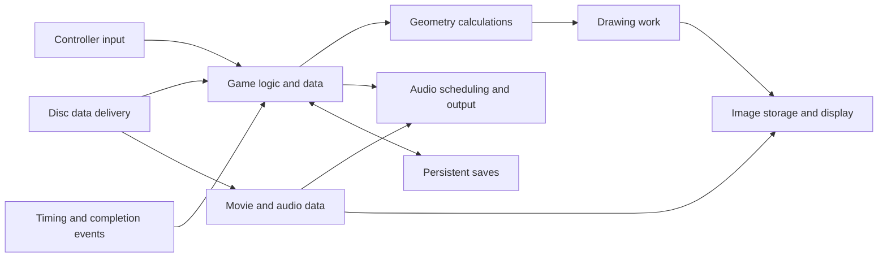

# PS1 research library

2026-10-22 · Three parallel researchers plus a coordinating research pass · Original annotations and reference metadata.

The result is a substantial discovery catalog, not a claim to have explained every circuit or found every surviving document. It combines **130 document/presentation links enumerated from live archival directories**, a **23-entry hardware source survey**, institutional holdings, search records, and a native Windows investigation agenda. The groups overlap; do not add their counts as unique sources. Directory listings are not 130 fully read or authenticated manuals.

## Start here

| File | Use |
|---|---|
| [BIOS analysis and continuing handoff](bios/README.md) | New REA/Ghidra investigation: startup, copied kernel, service lifecycle, exceptions, CD/GPU/input paths, evidence limits and proposed port validation. |
| [Native Windows handoff](NATIVE-WINDOWS-HANDOFF.md) | What the other MML1 agent can investigate next, proposed validation sequence, source boundaries, BIOS identity observation. |
| [Hardware dossier](HARDWARE.md) | CPU, geometry, graphics, memory, sound, disc/video, DMA/events, peripherals, physical design; primary-source catalog and reconstruction gaps. |
| [Sony document catalog](SONY-DOCUMENTS.md) | Verified manual editions; Net Yaroze filename correction; seminars; technical notes; FAQ/BBS collections; all 130 indexed links. |
| [Archival dossier](ARCHIVES.md) | Development boards/analyzer, hardware revision notes, Sony patent, service diagrams, physical institutional holdings. |
| [Search and method](SEARCH-AND-METHOD.md) | Lead's three exact query passes; research workflow and REA connection limitation. Each dossier also retains its own three-pass log. |
| [Machine-readable Sony index](sony-document-index.json) | Filename, URL, collection, observation date and directory-evidence status. `content_downloaded: false` means no local manual copy was acquired by the directory enumerator; it does not mean no researcher read that URL through a web tool. |
| [Combined source links](source-links.json) | Deduplicated navigation index extracted from all research reports. Inclusion inherits the report's evidence label; no blanket content/authenticity verification is implied. |
| [Validation record](VALIDATION.json) | JSON parsing, internal target checks, private-path scan, directory-entry count, and unique external link count. External URLs are not all independently re-fetched by this check. |

## How to learn the system

Work from the hardware dossier's conceptual map through each interface. For every interaction ask: who produces the data, where does it live, who consumes it, what starts the operation, what signals completion, what happens when it is late, and what visible state changes? This is an original study method, not an implementation specification.

This is a conceptual learning diagram, not a board schematic. Follow it with the native handoff's investigation sequence. Exact game dependencies must come from identified game evidence.

## Coverage and remaining depth

| Area | Established by this research | Still unresolved |
|---|---|---|
| CPU / memory / ABI | Vendor and Sony-origin reference locations and scope | Complete custom-core timing; game-specific arithmetic/address assumptions |
| GTE / GPU | Command/reference/seminar locations; revision-impact note | Full precision/edge conformance and revision matrix |
| DMA / timers / interrupts | Relevant OS/library/support collections identified | Complete register/cycle and concurrent-event behavior |
| SPU / CD / MDEC | Hardware/library/format/training families; component datasheet leads | Exact numerical, streaming, firmware and timing corner cases |
| Controllers / cards | Sony-hosted user manuals and developer-reference locations | Complete electrical protocol and accessory-variant evidence |
| Physical console | Board-specific service references and component leads | Custom-chip netlists/masks, all board revisions, analog tolerances, manufacturing and optical calibration |
| Historical development | Dev-board manuals, dated seminars, BBS/FAQ indexes, institutional catalog | Missing attachments, closed portals, Japanese originals, byte-level authenticity of mirrors |
| MML1 native Windows | Proposed dependency/validation agenda | Actual game/SDK revision, dependency inventory, assets and present implementation state |

## A finding worth prioritizing

Sony's [Revision-C technical note](https://psx.arthus.net/sdk/Psy-Q/DOCS/TECHNOTE/REVC.PDF) reports that changed graphics throughput could affect gameplay when synchronization assumptions were wrong. The engineering implication is to measure time and event dependencies explicitly when moving to a much faster PC. That inference does not establish that MML1 has this issue.

## Provenance matters

Many developer documents are Sony-authored but hosted unofficially and marked confidential/licensed-only. PSX-SPX's [own provenance notice](https://psx-spx.consoledev.net/) says it incorporates confidential Sony material. The reports preserve that distinction and cannot certify their own corpus as clean room. Official public consumer manuals, archival metadata, restricted developer documents, community references, and independent measurements are different evidence classes.

This repository contains research prose and links. BIOS bytes, proprietary SDK code/libraries, wholesale manuals, game assets, and other projects' implementations are excluded. Read [AGENTS.md](AGENTS.md) before extending the library.
